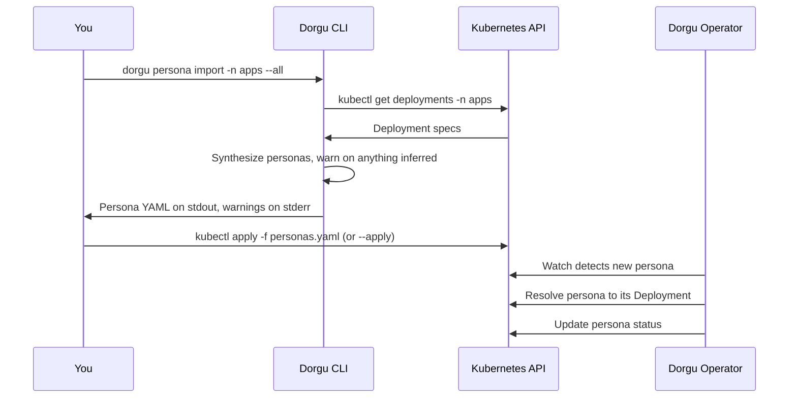
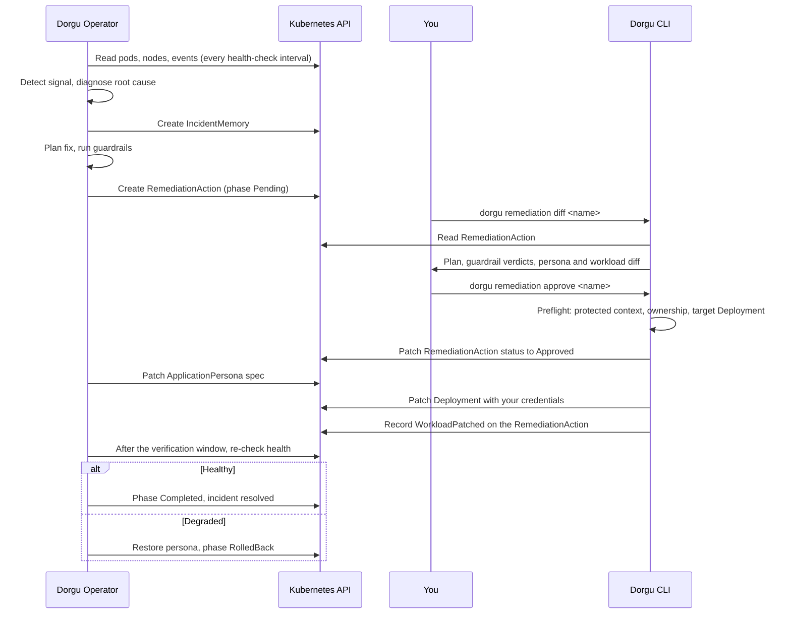
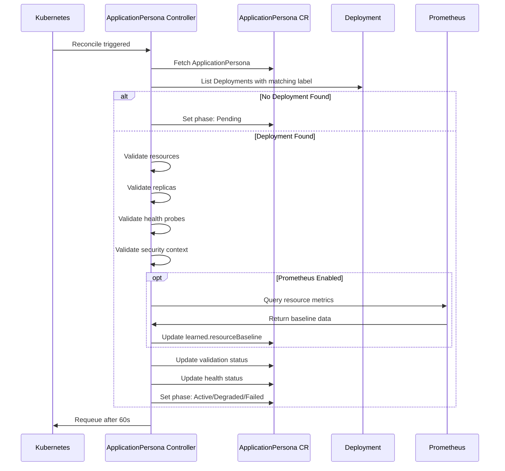
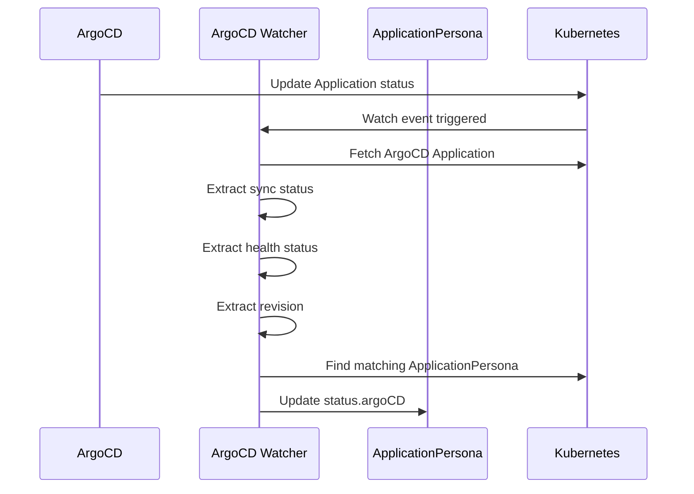
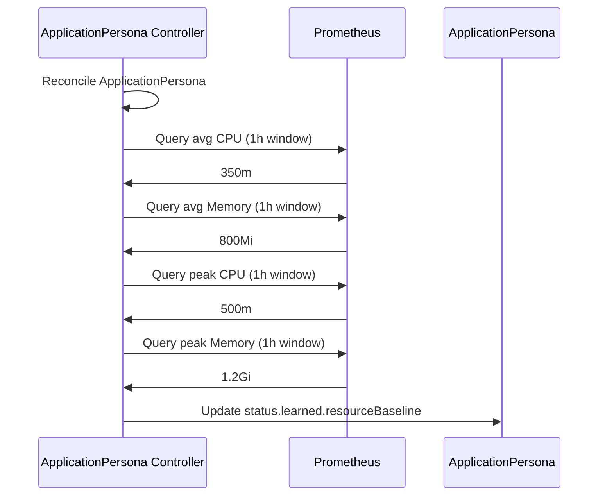
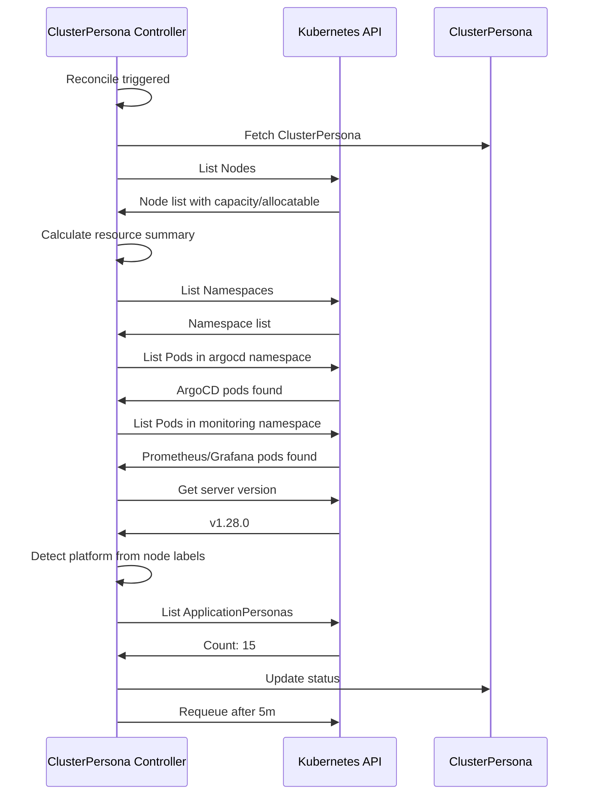
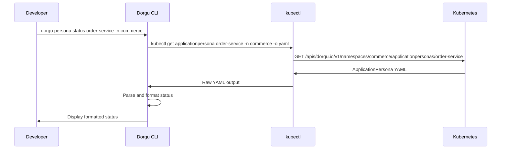
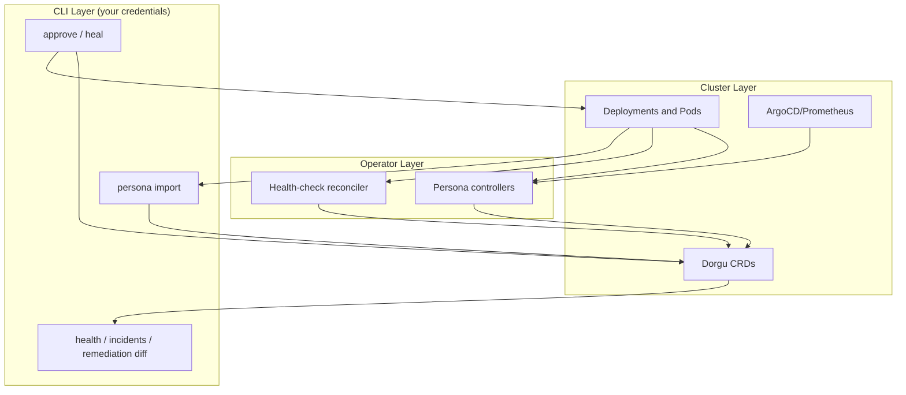

Dorgu has two halves. The Operator runs in your cluster: it observes, validates, detects, diagnoses, and proposes, and it writes only its own CRDs. The CLI runs as you: it reads what the Operator recorded, renders it for review, records your decision, and applies an approved change to the workload with your credentials. Integrations like ArgoCD and Prometheus feed the Operator additional context. This page walks through the key data flows with sequence diagrams.

## Onboarding an application

Dorgu only watches workloads that have an `ApplicationPersona`. On a cluster that already runs the app, `dorgu persona import` reads the live Deployment and synthesizes one.

Import never modifies a workload. The personas can equally be committed to Git and synced by your GitOps tool; the Operator does not care how they arrive.

## Detect, propose, approve, heal

This is the self-healing loop end to end. The Operator never writes the Deployment; the CLI does, as you, after you approve.

On a workload that Helm, ArgoCD, or Flux owns, the preflight stops the CLI before any write and it exits `4` with the owner-shaped steps instead. See [the ownership model](/ownership-model) and [`dorgu remediation`](/cli/commands/remediation).

## Async Validation (Controller)

The ApplicationPersona controller runs a continuous reconciliation loop. It re-validates every 60 seconds and optionally learns resource baselines from Prometheus.

The controller reconciles on watch events and on a 60-second timer. If Prometheus is available, it queries resource usage to build learned baselines over time.

## ArgoCD Integration

When ArgoCD is present in the cluster, the Operator watches ArgoCD Application resources and reflects their sync and health status into the corresponding ApplicationPersona.

The ArgoCD watcher extracts sync status, health status, and the current revision from ArgoCD Application objects, then writes them into the persona's `status.argoCD` field.

## Prometheus Baseline Learning

When Prometheus is available, the controller queries it during reconciliation to learn actual resource consumption patterns for each application.

The controller queries average and peak CPU/memory over a 1-hour window and stores the results in `status.learned.resourceBaseline`. These baselines can then power right-sizing recommendations.

## ClusterPersona Discovery

The ClusterPersona controller runs a discovery loop every 5 minutes to build a comprehensive picture of the cluster's state, capabilities, and installed add-ons.

The ClusterPersona controller discovers nodes, resource capacity, installed add-ons (ArgoCD, Prometheus, Grafana), Kubernetes version, platform type, and the total count of managed ApplicationPersonas.

## Persona Status Check

Checking the status of an ApplicationPersona retrieves the Operator's latest observations, including validation results, health status, and any recommendations.

The CLI fetches the raw ApplicationPersona from the cluster API and formats the status fields into a human-readable output showing phase, validation issues, health, and recommendations.

## Data Flow Summary

The following diagram shows how the major layers connect end-to-end.

The Operator reads workloads and integrations and writes only Dorgu's CRDs. The CLI reads those CRDs for review, writes your decisions back to them, and is the only part of Dorgu that changes a workload, with your credentials and after your approval.
