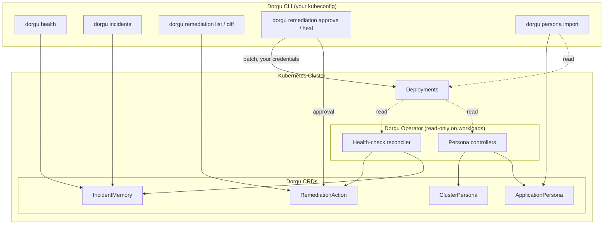

# System Architecture

Dorgu is a two-component system. The **Operator** runs in your cluster: it detects incidents, diagnoses their root cause, and proposes a fix as a `RemediationAction`. The **CLI** runs as you: it is how you read a proposal, approve or reject it, and apply the approved change to the running workload. The two never talk to each other directly. They communicate only through Kubernetes CRDs.

## System Diagram

## Component Overview

| Component | Repository | Description |
|-----------|------------|-------------|
| Dorgu CLI | `dorgu-ai/dorgu` | Review and approval surface for the self-healing loop; brownfield persona import |
| Dorgu Operator | `dorgu-ai/dorgu-operator` | Detection, diagnosis, proposals, verification, persona validation, cluster discovery |
| CRDs | `dorgu.io/v1` | `ApplicationPersona`, `ClusterPersona`, `IncidentMemory`, `RemediationAction`, `DorguEvent`. See the [CRD reference](/cli/architecture/crds). |

## What the CLI does

Every cluster command shells out to `kubectl` with your kubeconfig, through one helper that applies `--kubeconfig` and the global `--context` to every call. The CLI has no configuration file and makes no calls to a model provider.

| Command | Reads | Writes |
|---------|-------|--------|
| `health`, `incidents`, `remediation list`, `remediation diff`, `persona list`, `persona status`, `cluster status` | Dorgu CRDs and cluster state | Nothing |
| `persona import` | Deployments in one namespace | Nothing by default; `ApplicationPersona` objects with `--apply` |
| `remediation reject` | The `RemediationAction` | Its status, to `Rejected` |
| `remediation approve`, `remediation heal` | The `RemediationAction`, its persona, the target Deployment | The `RemediationAction` status, then the Deployment, with your credentials |

`approve` and `heal` run their checks before any write: the [protected-context guard](/cli/commands/remediation#protected-contexts), the plan, [workload ownership](/ownership-model), the target Deployment, and the container. If any check fails, nothing is written. Only resource limit and request changes are applied automatically; every other step in a plan is printed as a manual instruction and never executed. After the patch, the CLI records what it changed on the `RemediationAction`, so the record and the cluster agree.

The CLI does not verify the outcome or roll it back. The Operator does both.

## Design Principles

### Don't replace, integrate

Dorgu works with the deployment tooling you already have. It does not introduce a deployment format, and it will not patch a Deployment that Helm, ArgoCD, or Flux owns: it tells you what to change in your source of truth instead. See [the ownership model](/ownership-model).

### Operator is read-only on workloads

The operator **never** creates or modifies workload resources (Deployments, Services). It reads cluster state and writes only Dorgu's own CRDs. Kubernetes RBAC enforces this: its ClusterRole has no write verb on `apps/deployments`. See [security and permissions](/security-and-permissions).

### The workload change is made by you

The only Dorgu component that writes a workload is the CLI, running with your credentials, after you approve. The privilege to change a workload never leaves your hands. See [the trust model](/cli/architecture/trust-model).

### Source-of-truth hierarchy

You, `dorgu persona import`, or your GitOps pipeline own the `spec` of an `ApplicationPersona`, representing **desired intent**. The Operator owns the `status`, representing **observed reality** and learned patterns. The one exception is an approved remediation, where the Operator patches the persona's `spec` to the value you approved.

<Info>
  CLI `v0.13.0` removed the manifest generator, the cluster setup installer, and the WebSocket clients, along with the CLI's own LLM integration. See the [CLI migration guide](https://github.com/dorgu-ai/dorgu/blob/master/MIGRATION.md).
</Info>
