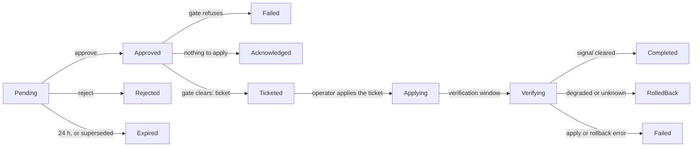

## Overview

The `dorgu remediation` command group is how you work with `RemediationAction` resources — the fixes the Dorgu Operator proposes after it detects and diagnoses an incident. You list them, read the proposed plan as a diff, then approve or reject.

Approving does two things: it records your decision on the `RemediationAction`, and where Dorgu is allowed to, it heals the running workload. The operator re-checks the approval on the live cluster and issues a short-lived **apply ticket**. It applies the ticket to the `ApplicationPersona` (desired state), and the CLI patches the `Deployment` with your credentials, using exactly what the ticket says. See [How Dorgu decides](/how-dorgu-decides) for the path and [Self-healing](/operator/features/self-healing) for the loop.

<Warning>
  **Needs CLI v0.14.0 together with operator v0.13.0.** An older CLI ignores the apply ticket and patches from the plan with none of the new checks. A `v0.14.0` CLI against an older operator refuses to patch, because no ticket ever arrives. Upgrade the CLI first: [upgrade guide](/upgrade-guide).
</Warning>

<Warning>
  **Dorgu will not patch a Deployment that Helm, ArgoCD, or Flux owns.** `approve` and `heal` read `spec.workloadRef` and decline for every `managedBy` except `unmanaged`, exiting **`4`** (`ExitDeclined`). Nothing is approved and nothing changes; instead you get the owner named and the fix restated as what to change in your source of truth.

  There is no `--force` and no override flag, on purpose. Read [the ownership model](/ownership-model) for why. The guard needs **CLI v0.10.0 or newer**, because an older CLI ignores the record and patches anyway: see [versions](/cli/installation#versions).
</Warning>

<Note>
  All subcommands shell out to `kubectl`, so `kubectl` must be on your `PATH`, and your current context, or the global `--context` flag, must point at the target cluster. Every `kubectl` call a command makes uses the same `--kubeconfig` and `--context`, so a command never reads one cluster and writes another. The alias `dorgu rem` works everywhere `dorgu remediation` does.
</Note>

## Exit codes

| Code | Meaning |
|------|---------|
| `0` | The command did what it was asked, including a `--no-heal` approval |
| `1` | Failure: unreachable cluster, missing kubeconfig, no `kubectl`, a failed API call, wrong phase, **no usable apply ticket** (none within 30 seconds, an expired one, or an operator older than v0.13.0), or an approval that did not stand because the operator expired or superseded the action. **Also the patched-but-unrecorded case below**, where the workload *was* changed |
| `4` | **Declined.** Dorgu understood the plan and chose not to write: something else owns the workload, or the operator's gate refused the approval on the cluster as it is now (`GateRefusedAtApproval`, with the reason shown). Nothing failed and nothing was applied. |

<Warning>
  **`4` is not a failure, and a wrapper that treats every non-zero exit as breakage will now misreport it.** Update the wrapper to accept `4`, or use `dorgu remediation approve <name> -n <ns> --no-heal`, which records the decision without a workload patch and exits `0`.
</Warning>

<Warning>
  **New in CLI v0.12.0: a non-zero heal no longer means "nothing happened".** `heal` and `approve` can now exit `1` **after** successfully patching your workload, when the patch landed but the record of it could not be written back to the `RemediationAction`. The workload is patched by then and **nothing is undone**.

  A script that treats non-zero as "the change did not apply, retry or roll forward" will be wrong about the cluster in exactly that case. Read the message: it names which way round the disagreement runs. See [when the record cannot be written](#when-the-record-cannot-be-written).
</Warning>

## Lifecycle



| Phase | What it means |
|-------|---------------|
| `Pending` | Waiting for your decision. The operator takes no action. After 24 hours (`remediation.pendingTTL`) it becomes `Expired`. |
| `Approved` | You approved it. The operator re-runs the gate on the live cluster. |
| `Ticketed` | **New in operator v0.13.0.** The gate cleared the approval and the operator wrote `status.applyTicket`, valid for 10 minutes. Normally visible only as a condition, because the operator applies the ticket in the same reconcile. |
| `Acknowledged` | You approved a plan that had nothing to apply. The approval is recorded, the operator changed nothing, and the incident is marked `acknowledged` rather than resolved, because nothing was fixed. |
| `Applying` | The ticket was applied to the persona. The operator is waiting out the verification window. |
| `Verifying` | The operator is re-running detection to check whether the original signal cleared. |
| `Completed` | Verification passed: the signal is gone and no new critical signals appeared. Whether Dorgu is credited with the heal is a separate record: see [heal credit](/how-dorgu-decides#heal-credit). |
| `RolledBack` | Verification found the health degraded (or could not be determined after retries), so the operator restored the persona fields it wrote. The Deployment is not rolled back by the operator. |
| `Failed` | The gate refused at approval (`Applied=False`, reason `GateRefusedAtApproval`, nothing applied), the ticket was refused at apply, or the apply or the rollback failed. |
| `Rejected` | You rejected it. |
| `Expired` | Terminal, nothing applied, no cooldown. The reason is on the `Expired` condition: `ApprovalTimedOut` (nobody decided within 24 hours, or the approval deadline passed), `Superseded` (the incident escalated to a worse shape and this proposal answered a milder one), or `PredatesGate` (the proposal was made by an operator older than v0.13.0, so it cannot be approved; the operator proposes again). |

Two condition reasons are worth knowing, both on the `Applied` condition. `AdvisoryOnly` accompanies `Acknowledged`. `PreconditionRejected` marks a plan the executor refused before touching the cluster, and `GateRefusedAtApproval` marks one the gate refused when you approved it. Neither starts the 30-minute failure cooldown, since nothing in the cluster actually went wrong.

<Warning>
  `Completed` only arrives **after the verification window** — 10 minutes by default (`spec.rollback.healthCheckAfter`). Your pod recovers within seconds of `approve`, but the remediation sits in `Applying` and then `Verifying` for the rest of that window. This is not stuck. It is the operator waiting long enough to be able to tell a real fix from a temporary one, so it can auto-roll-back if the health regresses.
</Warning>

---

## remediation list

### Synopsis

```bash
dorgu remediation list [flags]
```

Lists `RemediationAction` resources. By default it shows only active ones: `Pending`, `Approved`, `Ticketed`, `Applying`, `Verifying`, and `Failed`. Use `--all` to include `Completed`, `Acknowledged`, `RolledBack`, `Rejected`, and `Expired` (a superseded proposal is `Expired`).

### Flags

| Flag | Type | Default | Description |
|------|------|---------|-------------|
| `-n, --namespace` | string | all namespaces | Filter by namespace |
| `--phase` | string | all | Filter by exact phase (`Pending`, `Approved`, `Applying`, `Verifying`, `Completed`, …) |
| `--all` | bool | `false` | Include completed, rolled-back, rejected, and expired remediations |
| `--limit` | int | `50` | Maximum number of remediations to show |
| `--kubeconfig` | string | `kubectl`'s own resolution: `$KUBECONFIG`, then `~/.kube/config` | Path to kubeconfig file |
| `--json` | bool | `false` | Output as JSON (inherited global flag) |

### Example output

```
Active Remediations (1)

NAMESPACE   NAME                PHASE    TYPE            PLAN        STEPS  CONFIDENCE  PERSONA     AGE
production  fix-oom-api-server  Pending  persona-update  rule-based  2      0.90        api-server  4m
```

`PLAN: rule-based` is what a default install produces. It reads `ai-anthropic` where you have [turned the planner on](/operator/configuration/ai-setup).

### Output columns

| Column | Description |
|--------|-------------|
| NAMESPACE | Namespace of the RemediationAction |
| NAME | Resource name |
| PHASE | Lifecycle phase (see [Lifecycle](#lifecycle)) |
| TYPE | `spec.action.type`: `persona-update`, `notification`, or `git-pr` |
| PLAN | `rule-based` when the deterministic rules wrote the plan, which is the default, `ai-anthropic` when Claude did, `-` for older objects that carry no ordered plan |
| STEPS | Number of ordered steps in the plan, or `-` for a single-action object |
| GUARDRAIL | **Conditional.** The strongest verdict any of Dorgu's guardrails reached on any step of the plan. See below. |
| CONFIDENCE | Diagnosis confidence as a decimal string, e.g. `0.85` |
| PERSONA | Name of the persona being remediated |
| AGE | Time since the RemediationAction was created |

#### The GUARDRAIL column

It appears **only when there is something to put in it**, sitting beside `STEPS`. On a cluster where no guardrail has ruled on anything, the column is absent and the list prints exactly what it printed before.

```
NAMESPACE  NAME                   PHASE    TYPE            PLAN          STEPS  GUARDRAIL  CONFIDENCE  PERSONA   AGE
apps       fix-oom-checkout       Pending  persona-update  ai-anthropic  3      rejected   0.85        checkout  4m
apps       fix-oom-report-worker  Pending  persona-update  rule-based    2      -          0.90        worker    6m
```

Ranked by how much a reader needs to know: `rejected` (a field refused outright) over `clamped` (a value substituted) over `derived` (a value Dorgu sized itself), with `-` when no guardrail ruled.

**It is a pointer, not the record.** One word cannot carry a field-by-field account, and it does not try to. Read [`dorgu remediation diff`](#guardrail-verdicts) for what was actually decided.

Requires **operator v0.11.0** with **CLI v0.12.0**. Against an older operator the underlying `spec.steps[].safety` field is absent, the column never appears, and `--json` gains no `safety` key.

<Note>
  **There is no severity here.** `RemediationAction` carries no `severity` field, so this command cannot filter or sort by it — the blank `SEVERITY` column and the `--severity` flag that matched nothing were both removed. Filter by `--phase`, and read severity from the linked incident with [`dorgu incidents describe`](/cli/commands/incidents), where `--severity` does work.
</Note>

### Examples

```bash
# Active remediations across all namespaces
dorgu remediation list

# Only the ones waiting on you
dorgu remediation list --phase Pending

# Everything in one namespace, including terminal phases
dorgu remediation list -n production --all --limit 100

# JSON for scripting
dorgu remediation list --json
```

---

## remediation diff

### Synopsis

```bash
dorgu remediation diff <name> -n <namespace> [flags]
```

Shows the full proposal: the target, the workload and its owner, the confidence, the AI's plan summary, every step in execution order with its own YAML diff, and what the change does to the running Deployment. This is the review surface. Read it before you approve anything.

### Flags

| Flag | Type | Default | Description |
|------|------|---------|-------------|
| `-n, --namespace` | string | **required** | Namespace of the remediation |
| `--kubeconfig` | string | `kubectl`'s own resolution: `$KUBECONFIG`, then `~/.kube/config` | Path to kubeconfig file |
| `--json` | bool | `false` | Output the raw resource as JSON (inherited global flag) |

### Example output

```
Remediation: fix-oom-api-server
═══════════════════════════════

Target:     ApplicationPersona/api-server (production)
Workload:   Deployment production/api-server (container app)
Owner:      unmanaged (nothing reconciles it, so Dorgu may patch it)
Type:       persona-update
Confidence: 0.85
Plan:       ai-anthropic
Phase:      Pending
Incident:   im-oom

Explanation:
  AI remediation plan: 3 steps, 1 applied on approval and 2 advisory

Plan summary:
  Container OOMKilled due to a low memory limit.
  Increase the limit then restart the workload.

Plan (3 steps):

  [1] persona-update (low; auto): Increase memory limit to 512Mi
      256Mi is insufficient; container is OOMKilled
--- old
+++ new
@@ -1,3 +1,3 @@
 resources:
     limits:
-        memory: 256Mi
+        memory: 512Mi

  [2] restart (low; advisory): Restart the deployment to pick up new limits
      New limits only apply to new pods
      Run: kubectl rollout restart deployment/api-server -n production

  [3] manual (medium; advisory): Verify no further OOM events for 30m

Deployment change (production/api-server, container app):
  resources.limits.memory  256Mi -> 512Mi

Rollback:
  Automatic rollback if health degrades (verified after 10m0s)
  Max retries: 1

Actions:
  dorgu remediation approve fix-oom-api-server -n production
  dorgu remediation reject fix-oom-api-server -n production --reason <wrong-diagnosis|too-risky|not-now|duplicate|not-needed|other> [--note "..."]
```

Each step line reads `[order] type (risk; mode): description`, with the rationale indented underneath, an optional `Run:` command, and a unified diff of `prePatchState → patch` where the step carries one.

<Note>
  **There is no `Severity:` row.** `RemediationAction` carries no severity field. Read severity from the linked incident with [`dorgu incidents describe`](/cli/commands/incidents).

  `Explanation:` and `Plan summary:` say different things: the summary is the root cause (why it broke), the explanation is the shape of the response (what the plan will and will not do for you). They used to render the same paragraph twice; where an older operator wrote both fields identically, the CLI now prints it once.
</Note>

### The `Workload:` and `Owner:` header, and the Deployment change block

Two blocks in that output are about the thing that is actually failing, rather than about the persona.

**`Workload:` and `Owner:`** name the live Deployment the operator observed and who reconciles it. The persona is what Dorgu records; the workload is what runs, and on a brownfield cluster the two rarely share a name (persona `frontend` over Deployment `frontend-podinfo`). `Owner:` reads `unmanaged (nothing reconciles it, so Dorgu may patch it)` when Dorgu may write, and otherwise names the owner: `Helm release "frontend" in namespace apps`. Both lines are omitted when the operator resolved no workload at all.

**`Deployment change`** is a workload-to-workload diff, built from `workloadRef.observedResources`. The old diff read the *persona* on both sides, which is why a fix that silently introduced a CPU limit the container never had showed nothing at all:

```
Deployment change (apps/frontend-podinfo, container podinfo):
  resources.limits.memory  32Mi -> 128Mi
  resources.limits.cpu     not set -> 200m   (adds a key this workload does not set)
```

| Before column | Meaning |
|---------------|---------|
| A value | What the container actually had at proposal time |
| `not set` | Dorgu read the container and the key is absent. Never rendered as blank and never as zero. |
| `unknown` | Dorgu never observed the workload. "Not read" is a different fact from "not set". |

<Note>
  Adding a key the workload does not set is now refused at proposal time, so the `(adds a key this workload does not set)` marker should not appear on a v0.9.0 operator. It stays in the renderer because objects proposed by an older operator are still readable, and an added key is exactly the thing that must not be invisible.
</Note>

### On an owned workload

The header names the owner, and the suggested actions change: `approve` is not offered, because that command would be declined.

```
Target:     ApplicationPersona/frontend (apps)
Workload:   Deployment apps/frontend-podinfo (container podinfo)
Owner:      Helm release "frontend" in namespace apps
...

Deployment change (apps/frontend-podinfo, container podinfo):
  resources.limits.memory  32Mi -> 128Mi

Dorgu will not patch this Deployment: Helm release "frontend" in namespace apps owns it.
Make the change in the values for Helm release "frontend" in namespace apps (the key is
chart-specific, commonly under `resources`), then run your usual helm upgrade.

Actions:
  dorgu remediation approve fix-oom-frontend -n apps --no-heal   (record the decision, patch no workload)
  dorgu remediation reject fix-oom-frontend -n apps --reason <wrong-diagnosis|too-risky|not-now|duplicate|not-needed|other> [--note "..."]
```

Once the action leaves `Pending`, that action block is gone, so the Deployment change block carries the fact instead: `Dorgu did not apply this: <owner> owns this Deployment.`

### Guardrail verdicts

When one of Dorgu's guardrails has ruled on a field, `diff` prints what it decided under its own heading, per step, between the rationale and the diff that reflects it.

```
  [1] persona-update (low; auto): Set spec.resources.limits.memory to 512Mi on the ApplicationPersona.
      Dorgu decides what its guardrails permit, so the outcome above is Dorgu's own arithmetic
      against the workload it observed, not the plan's account of it.
      Dorgu guardrails (Dorgu's measurement, not the plan's):
        clamped  spec.resources.limits.memory  (blast-radius)
          requested 4Gi, baseline 256Mi, 16.0x against a 2.0x ceiling, applying 512Mi
          Blast-radius guardrail: the plan asked to set spec.resources.limits.memory to 4Gi, ...
        rejected  spec.resources.limits.cpu  (absent-field)
          requested 500m, applying nothing
          Left out: container "checkout" on checkout does not set cpu today, ...
```

<Warning>
  **Every number in that block is Dorgu's own arithmetic. None of it is the model's, and the model is not permitted to comment on a cap at all.** The heading says so out loud because the lines immediately above it, the description and the rationale, may be a model's prose, and the reader is about to approve a change to a running workload.

  It used to arrive as a `[safety:blast-radius] …` prefix on the model's `rationale`. In clean-room run #4 that put Dorgu's measurement one line below the model's claim that the same 16x change was "well within a 2x ceiling", with nothing to tell the reader which of the two had been computed.
</Warning>

Read the three columns of each entry as: what the guardrail decided, on which field, under which rule. Then the facts line, which answers what was asked for, what it was measured against, and what will actually happen.

| Verdict | The field's fate |
|---------|------------------|
| `clamped` | Refused, and Dorgu substituted a value it permits. `applying <value>` is what the patch carries, and it is what the diff below shows. |
| `rejected` | Refused, and nothing replaces it. The field is **gone from the patch**, so it appears in no diff. This block is the only place the reader learns it was asked for at all. |
| `derived` | The plan named the change but carried nothing appliable, so Dorgu computed the value itself from the live workload. |

`applying nothing` is stated rather than left to inference, because a missing word is not a fact a reader should have to notice.

The verdicts appear in **three** places, each of them the last screen before a decision:

| Where | Why there |
|-------|-----------|
| `dorgu remediation diff`, per step | The review surface. |
| The `approve` and `heal` preview, above the confirmation prompt | So a value a guardrail chose is visible before you answer `y`. |
| The [owned-workload refusal](/ownership-model#the-refusal) | That reader types the number into Helm values or Git, somewhere Dorgu will never see it, so they most need to know the ceiling was Dorgu's and not the plan's. |

<Note>
  **Printed once, not twice.** The operator writes a guarded step's `description` as its own sentence followed by each safety message verbatim, so that a client which knows nothing of the field still delivers the verdict. The CLI takes those messages back out of the description, so the verdict appears once, under the heading, with the numbers beside it, rather than twice, three lines apart.
</Note>

Requires **operator v0.11.0** with **CLI v0.12.0**. Against an older operator `spec.steps[].safety` is absent, no block is printed, and the step renders exactly as it did before. Full schema: [step safety fields](/cli/architecture/crds#step-safety-fields). How the verdicts are produced: [guardrail verdicts as data](/operator/features/self-healing#guardrail-verdicts-as-data).

### Ready-to-run commands on advisory steps

An advisory step is one Dorgu will not carry out for you. Where a single command does the job, the step carries it and `diff` prints it under the rationale:

```
  [2] workload-apply (low; advisory): Correct the mistyped image tag
      nginx:1.27-alpineX does not exist; the published tag is nginx:1.27-alpine
      Run: kubectl set image deployment/web web=nginx:1.27-alpine -n demo
```

This is the difference between a correct diagnosis and an actual fix. Before this existed, Dorgu would identify a mistyped image tag at 0.91 confidence, name the correct tag, link Docker Hub, and then leave you to write the `kubectl set image` yourself.

<Warning>
  **The command is only ever printed. Nothing executes it**, not the operator and not the CLI. Read it before you run it.

  Because the field can be written by an AI planner, the operator sanitizes it before storing it and the CLI re-checks it before displaying it: it must be a single line, start with `kubectl `, contain none of `; & | < > ` $`, and stay under 1024 characters. A command that fails any of those checks is not shown at all rather than shown with a warning.
</Warning>

Requires operator **v0.8.0** and CLI **v0.9.0** or newer. Older objects simply carry no command, and no `Run:` line is printed.

#### On an owned workload, only read-only commands are printed

A command that writes to a Deployment that Helm or ArgoCD owns takes field ownership from them and breaks their next apply, so it is not something to hand over. On an owned workload the CLI prints only commands it can positively classify as read-only:

| Kept | Dropped |
|------|---------|
| `kubectl logs`, `get`, `describe`, `events`, `top`, `diff`, `explain`, `auth`, `version`, `api-resources`, `api-versions`, `cluster-info` | `patch`, `apply`, `set`, `scale`, `edit`, `replace`, `create`, `delete`, `annotate`, `label`, `autoscale`, `expose`, `run`, `cordon`, `drain`, `uncordon`, `taint` |
| `kubectl rollout status`, `kubectl rollout history` | `kubectl rollout undo`, `restart`, `pause`, `resume`, and a bare `kubectl rollout` with no subcommand |

`kubectl logs` and `kubectl get events` matter **most** on the workloads Dorgu will not patch, because reading is the whole of what is left to hand over. Anything on an `unmanaged` workload is printed unchanged.

Classification is positive, not inferred from the absence of a write verb: a command whose verb matches nothing at all is refused rather than assumed harmless. The verb is found by scanning for the first token that is a known kubectl subcommand, so `kubectl -n apps patch ...` cannot hide `patch` behind a flag argument.

<Note>
  The operator already strips workload-writing commands before it stores the object. The CLI establishes read-only-ness again anyway, because the command is model-authored and the CLI reads `RemediationAction` objects straight out of the cluster, where an older operator or anything with permission to create the CRD could have written a `kubectl patch`. The shell-metacharacter check still runs first, on owned and unmanaged workloads alike.
</Note>

### Advisory plans

Some plans have nothing the CLI can apply, typically a `notification` action or a plan whose every step is advisory. Those say so plainly and offer only `reject`:

```
This plan is advisory: nothing in it can be applied for you.
Carry out the steps above yourself. Nothing changes in the cluster until you do.

Actions:
  dorgu remediation reject fix-image-web -n demo --reason <wrong-diagnosis|too-risky|not-now|duplicate|not-needed|other> [--note "..."]
```

Approving one anyway is safe: it records the approval, changes nothing, and settles the action as `Acknowledged`. It used to be offered `approve` as its suggested next action, and following that advice failed the remediation and put the app into a 30-minute cooldown.

| Part | Values | Meaning |
|------|--------|---------|
| `type` | `persona-update`, `workload-apply`, `restart`, `scale`, `config-change`, `manual` | What kind of change the step is |
| `risk` | `low`, `medium`, `high`, or `unknown` when unset | The AI's risk assessment for that step |
| mode | `auto` or `advisory` | `auto` means the step is applied for you; `advisory` means it is printed for a human to act on |

<Note>
  Only `persona-update` steps can ever be `auto`. The Kubernetes API server enforces this with a CEL validation rule on the CRD, so no plan — AI-written or otherwise — can mark a workload change as auto-executable.
</Note>

Older `RemediationAction` objects that carry a single `spec.action` instead of an ordered plan render a single `Proposed change:` diff rather than a `Plan (n steps):` block.

---

## remediation approve

### Synopsis

```bash
dorgu remediation approve [name] -n <namespace> [flags]
```

Approves a `Pending` remediation and, when Dorgu owns the write, heals the workload.

### What approval actually does

<Steps>
  <Step title="The CLI preflights the workload change">
    Before anything is written: the [protected-context guard](#protected-contexts), the remediation plan, **the ownership check**, the target Deployment, the container, and the patch. If any of it fails, nothing is approved. On an **owned** workload this is where the command stops: it prints the refusal and exits `4`, having written neither a Deployment patch nor a status patch.
  </Step>
  <Step title="The CLI records your decision">
    It patches the RemediationAction status subresource to `phase: Approved`, with `approvedBy: cli-user` and the current timestamp. The write carries the `resourceVersion` the CLI read. If anything wrote to the action in between, the CLI re-reads it. A status-only write is retried on the new version. If the spec changed since you read the plan (its `generation` moved), the CLI refuses the retry and tells you to re-run `dorgu remediation diff`, because the approval would land on a plan you never saw. If someone else's approval landed first and stands (`Approved`, `Ticketed`, or `Applying` with a ticket), it says `already approved by another actor`, writes nothing, and exits `0` without healing. Run `dorgu remediation heal` to apply it. "Approved" is printed only after a short settle, once the operator still has the approval standing. If the operator expired or superseded the action in that moment, the CLI says what it became and exits `1`.
  </Step>
  <Step title="The operator re-checks the approval and writes a ticket">
    The operator runs its gate again on the live cluster: the same workload, an unedited spec, current policy, current guardrail arithmetic. If it clears, it writes `status.applyTicket` (the Deployment's UID and generation, the container, the exact patch, every verdict, and an expiry **10 minutes** out) and the phase becomes `Ticketed`. If it refuses, the action ends `Failed` with `GateRefusedAtApproval` and nothing is applied. See [the approval-time re-check](/how-dorgu-decides#the-approval-time-re-check-and-the-apply-ticket).
  </Step>
  <Step title="The operator applies the ticket to the ApplicationPersona">
    It applies the ticket's patch to the persona's `spec`, the app's desired-state record, then moves the action to `Applying`. It never touches your Deployment, and it cannot: its ClusterRole has no write verbs on `apps/deployments`. See [security and permissions](/security-and-permissions).
  </Step>
  <Step title="The CLI waits for the ticket, then heals the workload">
    The CLI waits up to **30 seconds** for the ticket (a spinner on a terminal, one line when piped). It uses only a ticket the operator issued at or after your approval was recorded, with at most ten minutes of life. It then patches the matching Deployment with **your** credentials, with the ticket's change in the ticket's container, and **nothing from the plan you previewed**. If the ticket differs from the preview, it says so. Use `--no-heal` to skip this.
  </Step>
  <Step title="The CLI records the patch">
    A `WorkloadPatched` condition is stamped on the RemediationAction naming the Deployment, container, and fields it set, so the record and the cluster agree. The phase is already `Approved` or later by this point, so only the condition is written. See [what the heal records](#what-the-heal-records). The operator uses that condition when it decides [heal credit](/how-dorgu-decides#heal-credit).
  </Step>
</Steps>

<Warning>
  **The CLI refuses to patch, and applies nothing, when:** no ticket arrives within 30 seconds (including against an operator older than v0.13.0, with an upgrade hint); the ticket has expired; the ticket was already on the action before you approved; the Deployment's UID is not the one the ticket names, or its `metadata.generation` has moved since; `--container` disagrees with the ticket; the cluster's self-healing mode is `observe` or cannot be read; or the live Deployment carries Helm, Argo CD or Flux stamps, a controller owner reference or a GitOps field manager, whatever the proposal recorded. It re-reads the action, the Deployment and the ClusterPersona right before it writes, after any confirmation prompt. It never falls back to patching from the plan.
</Warning>

When the action is not approved, the CLI says so and why. A proposal the operator superseded or expired is phase `Expired`, and the sentence follows the `Expired` condition's reason:

```
✗ fix-oom-api-server is NOT approved (phase Expired): the operator superseded it with a newer proposal for the same fault, which is worse than the one it answered. Run `dorgu remediation list` for the current one.
ℹ Nothing was applied to the persona or the workload.
```

| Reason | What the CLI says |
|--------|-------------------|
| `Superseded` | The operator superseded it with a newer proposal for the same fault, which is worse than the one it answered. Run `dorgu remediation list` for the current one. |
| `ApprovalTimedOut` | The operator expired it: it waited in `Pending` longer than its time-to-live. Run `dorgu remediation list`; the incident may have a fresh proposal. |
| `PredatesGate` | It predates the operator's gate (it was made by an older operator), so it cannot be approved. The operator proposes again. See below. |

An approval of a proposal that predates the gate is shown as the gate's refusal (`NoProposalRecord`, exit `4`) with a `Note:` line carrying the operator's own account, and not as "ended in phase Expired".

When the operator's gate refuses the approval, the CLI shows the reason the operator persisted and exits `4`:

```
The operator's gate refused this approval on the cluster as it is now.
  Reason:  BlastRadius
  Detail:  resource change for spec.resources.limits.memory exceeds maximum: ...

Nothing was applied to the persona or the workload.
```

The reason is a stable name such as `BlastRadius`, `WorkloadGone`, `NoProposalRecord`, `SpecChanged`, `SelfHealingMode` or `Concurrent`. It is also on the action as the reason of its `GateRefused` condition.

Advisory steps (`restart`, `scale`, `config-change`, `manual`, and any `persona-update` that is not a resource change) are printed as numbered manual instructions. They are never executed.

<Warning>
  **Approval is withheld along with the patch.** On an owned workload the ownership check sits in the preflight, ahead of any write, so `approve` records nothing at all.

  That is deliberate rather than incidental. Approving is what tells the operator to patch the persona and start the verification clock, so approving a change the CLI will not apply would leave the persona at 128Mi, the workload at 32Mi, and a ten-minute verification window running over a fix that was never coming. Use `--no-heal` when you want the decision recorded and intend to apply the change at its source yourself.
</Warning>

### On an owned workload

```
$ dorgu remediation approve fix-oom-frontend -n apps

Dorgu will not patch this workload.

  Workload: Deployment apps/frontend-podinfo (container podinfo)
  Owner:    Helm release "frontend" in namespace apps

  A direct patch would claim the fields it sets away from Helm release "frontend"
  in namespace apps, and your next helm upgrade would then fail with a
  field-manager conflict.

Deployment change (apps/frontend-podinfo, container podinfo):
  resources.limits.memory  32Mi -> 128Mi

Apply it where this workload's desired state lives:
  [1] Set resources.limits.memory: 128Mi in the values for Helm release "frontend"
      in namespace apps (the key is chart-specific, commonly under `resources`),
      then run your usual helm upgrade for that release.

Nothing was approved and nothing in the cluster was changed.
To record the decision without a workload patch: dorgu remediation approve fix-oom-frontend -n apps --no-heal

$ echo $?
4
```

The owner-shaped steps come from the operator, which generated them at proposal time, so the refusal and the plan send you to the same place. Where the plan carries no owner-shaped step, the CLI builds one instruction from the concrete resource change, so a refusal is never a dead end.

Read [the ownership model](/ownership-model) for how ownership is detected and what each owner's failure mode is.

### Flags

| Flag | Type | Default | Description |
|------|------|---------|-------------|
| `-n, --namespace` | string | required unless `--next` | Namespace of the remediation |
| `--next` | bool | `false` | Approve the oldest pending remediation instead of naming one |
| `--reason` | string | `""` | Optional approval note, echoed in the success message. Free text. (`reject --reason` is different: it takes a fixed list.) |
| `--heal` | bool | `true` | After approval, apply the resource change to the workload. Only ever acts on an `unmanaged` workload. |
| `--no-heal` | bool | `false` | Skip the workload heal; only patch the RemediationAction status |
| `--workload` | string | auto-discovered | Explicit Deployment name. Must **match** the workload recorded in `spec.workloadRef`; it cannot redirect the patch elsewhere. |
| `--container` | string | the container the operator observed | Explicit container name to patch |
| `--yes` | bool | `false` | Skip the heal confirmation prompt |
| `--kubeconfig` | string | `kubectl`'s own resolution: `$KUBECONFIG`, then `~/.kube/config` | Path to kubeconfig file |

`--heal` and `--no-heal` are mutually exclusive.

<Note>
  `--next` takes the **oldest** pending remediation, so the longest-waiting incident goes first; ties break on namespace and name, making the pick reproducible. It previously ranked by severity, which `RemediationAction` does not carry — every candidate tied, so the winner was effectively arbitrary.
</Note>

<Warning>
  **`--workload` can no longer aim the patch at a different Deployment.** It still resolves the workload, but the name must agree with the one in `spec.workloadRef`, and a mismatch is refused:

  ```
  refusing to patch Deployment frontend-canary: Dorgu checked ownership for
  frontend-podinfo, and a decision about one workload does not carry to another
  ```

  Ownership is a fact about one specific object, so a flag that redirects the patch to a Deployment the operator never observed is the guard with a hole in it: Dorgu would clear `frontend` as unmanaged and then write to `frontend-canary`, which Helm owns.

  **`--container` still overrides freely,** because ownership is per-Deployment, not per-container. Omit it and the CLI uses the container the operator actually read, so the patch targets the same container whose values were the diff's before-state.
</Warning>

### Examples

```bash
# Review, then approve and heal (prompts before patching the Deployment)
dorgu remediation diff fix-oom-api-server -n production
dorgu remediation approve fix-oom-api-server -n production

# Non-interactive — used in the demo flow
dorgu remediation approve fix-oom-api-server -n production --yes

# Record the approval but apply the workload change yourself:
# GitOps, a Helm release, or any workload Dorgu will not patch
dorgu remediation approve fix-oom-api-server -n production --no-heal

# Patch a different container in the observed Deployment
dorgu remediation approve fix-oom-api-server -n production --container app
```

### Recording a decision without a patch

`--no-heal` is how you say "I have read this, I agree, and I will apply it myself". It records `phase: Approved`, lets the operator re-check, issue a ticket and patch the persona spec, skips the Deployment patch, and exits **`0`**.

It is the intended path in three situations: an owned workload, a GitOps-managed persona, and any time you would rather apply the change through your own pipeline.

The CLI warns that the persona and the running workload will disagree until you do apply it. Heed that: the operator's verification window will run against a workload that has not changed yet.

<Note>
  The target Deployment is resolved **before** the approval is recorded. If the workload cannot be found, nothing is approved and nothing is changed, and the error lists the Deployments that are present. Approving first and failing to resolve afterwards used to leave the persona at the new limits, the workload at the old ones, and a 10-minute verification window running over a change that never landed.
</Note>

If a heal does fail after approval, the CLI names the divergence rather than reporting success: `the remediation is Approved but <ns>/<deployment> was NOT patched; the persona and the workload now disagree`. `--no-heal` warns about the same divergence up front.

That is the divergence where the **workload** did not change. Since CLI v0.12.0 there is a second, opposite one: the workload changed but the **record** could not be written. Both exit non-zero, and both name which way round they run, because they call for different responses. See [when the record cannot be written](#when-the-record-cannot-be-written).

Only `Pending` remediations can be approved. Anything else exits with an error naming the current phase.

---

## remediation reject

### Synopsis

```bash
dorgu remediation reject <name> -n <namespace> [flags]
```

Moves a remediation to `Rejected`. Works from `Pending` or `Approved`: any other phase is refused.

### Flags

| Flag | Type | Default | Description |
|------|------|---------|-------------|
| `-n, --namespace` | string | **required** | Namespace of the remediation |
| `--reason` | string | `""` | Why, from a fixed list: `wrong-diagnosis`, `too-risky`, `not-now`, `duplicate`, `not-needed`, `other`. Optional, but record it. |
| `--note` | string | `""` | A sentence of context stored with the reason. **Required with `--reason other`.** |
| `--kubeconfig` | string | `kubectl`'s own resolution: `$KUBECONFIG`, then `~/.kube/config` | Path to kubeconfig file |

<Warning>
  **Breaking in CLI v0.14.0: `--reason` is a fixed list, not free text.** `--reason "will handle manually"` is now an error that lists the valid values. Put the sentence in `--note` and use `--reason other`. A script that passed free text has to change. Leaving `--reason` out still rejects.
</Warning>

| Reason | Use it when |
|--------|-------------|
| `wrong-diagnosis` | Dorgu misread what is wrong. **The only reason that counts against proposal precision** in [`dorgu report`](/cli/commands/report). |
| `too-risky` | The change is right but not safe to make here |
| `not-now` | The fix is right but this is the wrong time (a peak, a freeze, a deploy in flight) |
| `duplicate` | The same fix is already proposed or applied |
| `not-needed` | There is nothing to fix, or it fixed itself |
| `other` | None of the above. Requires `--note`. |

```bash
dorgu remediation reject fix-oom-api-server -n production --reason wrong-diagnosis
dorgu remediation reject fix-oom-api-server -n production --reason too-risky --note "peak traffic"
dorgu remediation reject fix-oom-api-server -n production --reason other --note "handling in the 1.4 release instead"
```

The reason is recorded on the RemediationAction as a `RejectionReason` status condition, written in the same patch that sets the phase, so a rejection never exists without it. The condition's reason is the CamelCase of the flag (`WrongDiagnosis`, `TooRisky`, and so on) and its message is the note. Nothing parses the note.

A rejection holds the same fix for the same incident for one hour. A rejection of a milder shape does not hold a strictly worse shape of the same fault. See [How Dorgu decides](/how-dorgu-decides#the-gate-six-stages).

Rejecting is also a safety gate: `dorgu remediation heal` refuses to run against a rejected remediation.

---

## remediation heal

### Synopsis

```bash
dorgu remediation heal <name> -n <namespace> [flags]
```

Applies an approved remediation's resource change to the workload on its own, then [records that it did](#what-the-heal-records). `approve` runs this for you unless you passed `--no-heal`, so reach for `heal` when you deferred the apply, or when a previous heal failed and you want to retry it.

**`heal` is not an approval.** It applies the operator's [apply ticket](/how-dorgu-decides#the-approval-time-re-check-and-the-apply-ticket), not the plan, and a ticket exists only for an action a human approved. Healing a `Pending` remediation is refused: approve it first. It works only while the operator still holds the action in `Approved`, `Ticketed` or `Applying`, and the ticket lives 10 minutes. `Applying` is the operator's verification window, so after `approve --no-heal` you have that long. Once the action is `Verifying` or `Completed`, `heal` is refused, because the operator's verdict would be about a workload nobody changed. Apply the change yourself instead.

Within those limits it is idempotent, which is what makes re-running it the fix for a heal that patched but could not record.

### Flags

| Flag | Type | Default | Description |
|------|------|---------|-------------|
| `-n, --namespace` | string | **required** | Namespace of the remediation |
| `--workload` | string | auto-discovered | Explicit Deployment name. Must match the workload recorded in `spec.workloadRef`. |
| `--container` | string | the container the operator observed | Explicit container name to patch |
| `--yes` | bool | `false` | Skip the confirmation prompt |
| `--kubeconfig` | string | `kubectl`'s own resolution: `$KUBECONFIG`, then `~/.kube/config` | Path to kubeconfig file |

### How the workload is found

<Steps>
  <Step title="Ownership">
    The first gate. `spec.workloadRef.managedBy` must be `unmanaged`. Everything else, including `unknown` and an absent `workloadRef`, is declined with the refusal and exit code `4`. Nothing after this step runs.
  </Step>
  <Step title="Ticket">
    The action must carry a ticket the operator issued at or after the approval on record (`status.applyTicket.issuedAt`), unexpired, with a lifetime of at most ten minutes, in phase `Ticketed` or the `Applying` the operator moves to in the same pass. A ticket already sitting on the action, one issued before the approval, one with no issue time, and one on an action already `Verifying` or `Completed` are ignored. Without a usable ticket nothing is patched.
  </Step>
  <Step title="Namespace">
    The persona's namespace (`spec.personaRef.namespace`), falling back to the remediation's own namespace. Never anywhere else.
  </Step>
  <Step title="Deployment">
    Every Deployment in that namespace is a candidate, and the CLI walks the same ordered chain the operator uses, taking the first rung that matches exactly one Deployment: the `app.kubernetes.io/name` label, then the `app` label, then `metadata.name`, then `spec.selector.matchLabels`. All against the persona's `spec.name`.

    **No label is required on the Deployment object.** Helm, kustomize, and most hand-written YAML label the pod template only; that resolves on the last rung. Zero matches and an ambiguous rung are both errors, and both list the Deployments actually present in the namespace and point at `--workload`. See [discovery](/operator/features/self-healing#how-a-persona-finds-its-deployment).

    Whatever this resolves to, and however it was resolved, it must **agree with `spec.workloadRef.name`**. A mismatch is refused rather than patched.
  </Step>
  <Step title="Container">
    The container the operator observed, unless `--container` names another. Failing that, the only container if there is one, otherwise the container whose name matches the app. Anything else asks for `--container`.
  </Step>
  <Step title="Patch">
    A strategic-merge patch that sets exactly the `resources.limits` and `resources.requests` fields the ticket carries (`cpu` and `memory` only), in the ticket's container, and nothing broader. The Deployment is matched on the UID and `metadata.generation` the ticket names, so a status or scale write does not invalidate a good ticket, and a spec change does. It runs under the field manager `dorgu` rather than kubectl's default `kubectl-patch`, so the entry it creates is distinguishable from a `kubectl patch` you ran yourself.
  </Step>
  <Step title="Release">
    The `dorgu` entry is then removed from `metadata.managedFields` and the object is read back to confirm it is gone, so a heal leaves **no ownership footprint** and a later server-side apply does not conflict with it. If the removal fails, the heal still succeeded and the CLI says loudly what is left behind and how to clear it. **New in CLI v0.11.0.** See [Dorgu leaves no field manager behind](/ownership-model#dorgu-leaves-no-field-manager-behind).
  </Step>
  <Step title="Record">
    The `RemediationAction` is updated to say what just happened, so the record and the cluster agree. **New in CLI v0.12.0.** See [what the heal records](#what-the-heal-records).
  </Step>
</Steps>

### What the heal records

After a patch the cluster accepted, and only after one, the CLI stamps a `WorkloadPatched` condition on the RemediationAction. It names the namespace, the Deployment, the container, and each field that was set.

```bash
$ kubectl get remediationaction fix-oom-report-worker -n apps -o yaml
```

```yaml
status:
  phase: Applying
  approvedBy: cli-user
  conditions:
    - type: WorkloadPatched
      status: "True"
      reason: CLIAppliedResourceChange
      message: dorgu CLI applied resources.limits.memory=128Mi to Deployment apps/report-worker (container worker)
```

The CLI does not move the phase of an action. That lifecycle belongs to the operator, and `heal` no longer approves anything, so the only thing it writes is the condition.

The condition matters beyond the record: the operator reads it when it decides whether Dorgu is **credited** with the heal. A recovery with no `WorkloadPatched` (a `--no-heal`, a declined prompt, a patch that changed nothing) is recorded as `self-resolved`, not as a Dorgu heal. See [heal credit](/how-dorgu-decides#heal-credit).

<Note>
  The write is a read-modify-write, because conditions are keyed by type and adding one means sending the whole list. Every other writer's condition goes back as raw JSON byte for byte, the CLI's own prior marker is replaced rather than appended, the `resourceVersion` is sent as a precondition, and a conflict is retried against fresh state three times before it is reported. Round-tripping the operator's conditions through a struct would silently drop fields the CLI does not know about.
</Note>

### When the record cannot be written

The workload is patched by then, so nothing is undone. But the command **exits `1`** and says which way round the disagreement runs, because exiting `0` there would reproduce the defect above:

```
✓ Healed apps/report-worker (container worker). The pod will restart with the updated resources.
⚠ apps/report-worker was patched, but Dorgu could not record that on the remediation: ...
  The cluster has resources.limits.memory → 128Mi and remediationaction apps/fix-oom-report-worker does not say so.
  Close the gap by re-running the heal, which will record it on the way through:
    dorgu remediation heal fix-oom-report-worker -n apps
  Until then, treat the remediation record as incomplete rather than as evidence.
```

The re-run works only while the ticket is still valid (10 minutes) and the action is still `Ticketed` or `Applying`. After that, the heal is refused and the record stays incomplete. The Deployment is patched either way, so check it with `kubectl get deploy`.

Note that the success line still prints, because the heal genuinely succeeded. It is the *record* that failed, and the two are reported separately.

<Note>
  **No paste-ready `kubectl patch` is offered, on purpose.** The only patch that would work replaces the whole `conditions` list, so handing one over would have you overwrite the operator's own conditions to fix a record bug. Re-running the heal is both shorter and safe: it is idempotent, and it records the change on the way through.
</Note>

This is the same class as the field-manager footprint warning, with one deliberate difference. A failed footprint strip leaves the heal green, because it is a future apply conflict rather than a wrong record. A failed record write is not green, because a record that contradicts the cluster is the thing being fixed.

### Safety gates

| Gate | Behavior |
|------|----------|
| **Workload owned by Helm, ArgoCD, or Flux** | **Declined, exit code `4`.** Prints the owner, the Deployment diff, and the owner-shaped steps. No `--force` exists. A `managedBy: kustomize` workload is declined identically, but that value is only ever set from an [opt-in marker](/ownership-model#the-kustomize-limitation). |
| **`spec.workloadRef` absent** | **Declined.** Treated as owned: it means either an operator older than v0.9.0 or a workload that could not be read, and neither is evidence that patching is safe. |
| Resolved Deployment disagrees with `workloadRef.name` | Refused. A decision about one workload does not carry to another. |
| Phase `Rejected`, `Failed`, `Expired`, `RolledBack` | Refused. |
| Phase `Pending` or unset | **Refused.** `heal` is not an approval, and a ticket exists only for an approved action. Approve it first. |
| Phase `Approved`, `Ticketed`, `Applying` | Proceeds, with the operator's ticket. This is the expected path. |
| Phase `Verifying`, `Completed` | **Refused.** The operator's verdict would be about a workload nobody changed. |
| No ticket, an expired ticket, or a ticket issued before the approval on record | Refused, with an upgrade hint when the operator is older than v0.13.0. |
| Deployment UID or `metadata.generation` differs from the ticket | Refused. |
| Cluster self-healing mode is `observe`, or cannot be read | Refused. |
| Protected context | Refused if the kube-context name contains any pattern in `DORGU_PROTECTED_CONTEXTS` (default `prod`). See [protected contexts](#protected-contexts). |
| Confirmation | Prints the namespace, Deployment, container, and the exact field changes, then prompts `[y/N]` unless `--yes` is set. It also states the limit of the `unmanaged` classification: nothing Dorgu can see reconciles this Deployment, and [a kustomize overlay leaves no marker](/ownership-model#the-kustomize-limitation), so re-applying one would revert the change. |

### Protected contexts

Before `approve` writes an approval, and before `heal` patches a workload, the CLI checks the name of the kube-context it is about to write through and refuses if the name contains a protected pattern. An approval is refused with or without `--no-heal`, because approving is itself a change: it tells the operator to update the persona. The context it checks is the global `--context` value when you pass one, and the kubeconfig's current-context otherwise, so the name it checks is always the context the patch goes to.

The patterns come from `DORGU_PROTECTED_CONTEXTS`: comma-separated, case-insensitive substrings. The default is `prod`. An unset or blank value falls back to `prod` rather than turning the guard off, because an empty variable is far more often an accident than a decision to heal production.

```bash
# Default: any context whose name contains "prod" is refused
dorgu remediation approve fix-oom-api-server -n production

# Protect two patterns instead of the default
export DORGU_PROTECTED_CONTEXTS=production,live

# Point one command at a specific context; this is the name the guard checks
dorgu remediation heal fix-oom-api-server -n staging --context kind-dorgu-dev
```

A refusal exits `1` and names the context and the pattern it matched. It opens with the command you ran, so the message is never about something you did not ask for:

| You ran | The refusal opens with |
|---------|------------------------|
| `approve --no-heal` | `refusing to approve` |
| `approve` | `refusing to approve and heal` |
| `heal` | `refusing to heal` |

```
refusing to approve and heal: kube-context "eks-prod-eu" matches protected pattern "prod" (DORGU_PROTECTED_CONTEXTS); switch to a non-production context
```

This guard **writes nothing to the cluster it protects**, not even an Event: it declines locally, on stderr, and [`dorgu report`](/cli/commands/report) does not count it. Every other CLI decline is recorded as a Warning Event on the RemediationAction.

<Warning>
  **This is a name check and nothing more.** It is a seatbelt against healing the wrong cluster by accident, not a security boundary: a context with a different name passes it. `aws eks update-kubeconfig` names contexts after the cluster ARN, so an EKS cluster whose name contains `prod` is refused under the default. Narrow the patterns if that is not what you want.
</Warning>

<Note>
  The ownership gate runs before the plan is resolved against the cluster, and an **advisory-only** plan never reaches it: there is no workload change to refuse, so an advisory remediation behaves identically on owned and unmanaged workloads.
</Note>

```bash
# Re-run the workload sync after --no-heal
dorgu remediation heal fix-oom-api-server -n production

# Skip the prompt
dorgu remediation heal fix-oom-api-server -n production --yes
```

<Warning>
  `heal` only auto-applies **resource limits and requests** (`cpu`, `memory`) — the OOM and saturation path. A remediation with no resource change reports that there is nothing to heal automatically and prints its advisory steps instead.
</Warning>

---

## Next steps

<CardGroup cols={2}>
  <Card title="Ownership model" icon="user-lock" href="/ownership-model">
    Why a Helm or ArgoCD-owned workload is declined, and what to do instead
  </Card>
  <Card title="Self-healing" icon="heart-pulse" href="/operator/features/self-healing">
    How detection, diagnosis, planning, and verification fit together
  </Card>
  <Card title="AI setup" icon="sparkles" href="/operator/configuration/ai-setup">
    Turn on the AI planner with your own Anthropic key
  </Card>
  <Card title="dorgu incidents" icon="triangle-exclamation" href="/cli/commands/incidents">
    Inspect the IncidentMemory a remediation was proposed for
  </Card>
  <Card title="CRD reference" icon="file-code" href="/cli/architecture/crds">
    Full RemediationAction schema, including `steps[]` and rollback
  </Card>
</CardGroup>
