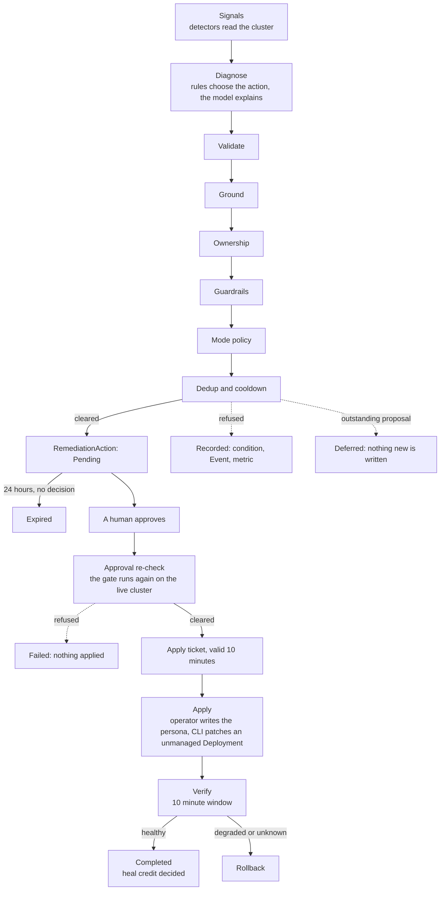

Dorgu detects a failure, diagnoses it, and proposes a fix. A human approves. Only then does anything change, and Dorgu itself writes to your workload only when nothing else owns it.

This page follows one proposal from the first signal to the verified result, and names every point where Dorgu can say no. It describes operator `v0.13.0` with CLI `v0.14.0`. If you run older versions, read the [upgrade guide](/upgrade-guide) first, because the approval-time checks below do not exist before them.

<Note>
  **What this page claims, and what it does not.** Dorgu does not heal a cluster on its own. It proposes, you decide, and the checks on this page narrow or refuse a change. They do not make a change correct. The [limits](#limits) section lists what the checks cannot see.
</Note>

## The path

The six boxes from Validate to Dedup and cooldown are the **gate**. One piece of code runs them, and it runs twice for every fix: once when Dorgu proposes, and again when you approve. Nothing else in Dorgu decides whether a change is safe.

## Detection and diagnosis

Detectors read pod status, kubelet events, node conditions and (if installed) metrics-server. They produce **signals** such as `OOMKilled`, `CrashLoopBackOff` or `ReadinessNotReady`. The health-check reconciler groups signals by application and opens or updates an `IncidentMemory`. See [Detect](/operator/features/self-healing#detect).

Diagnosis is structured, and the two providers have different jobs:

- **The rules own the suggested action.** The rule-based provider is always on. It chooses the action class (for example `resource-adjustment`) and the deduplication key. Nothing else can change either one.
- **The model explains.** With AI on, the model returns `summary`, `rootCause`, `recommendedAction` and `confidence` as strict JSON. Anything that does not validate is discarded and the rule-based diagnosis stands. Dorgu uses the model's `summary` as the incident's text. The model's `recommendedAction` and `confidence` are logged and never acted on.
- **The model is asked only when the situation changes.** Replies are cached by the incident's signal fingerprint for `llm.cacheTTL` (default `30m`).

The practical effect: text written by a model never selects an action, a patch, or a phase. A model can make a root cause read better. It cannot make a proposal bigger or different.

## The gate: six stages

At proposal, a candidate plan (from the rule engine or the optional AI planner) passes the stages in order. The first refusal ends the run. Each stage reads the live cluster itself rather than trusting the plan or the persona.

| Stage | What it checks | What it refuses, and why |
|-------|----------------|--------------------------|
| **Validate** | The plan's shape, before anything is read from the cluster | A step type Dorgu does not know, a persona change aimed at anything but an `ApplicationPersona`, a persona change when the rules did not recommend a resource adjustment for this diagnosis, a step command that is not one plain `kubectl` invocation, a patch that is not a plain JSON object. A persona change may set only CPU or memory quantities under `resources`; anything else is removed and recorded. The plan's own verification window and rollback settings are ignored in favor of the operator's. A model can word a plan, but it cannot change what kind of change it is. |
| **Ground** | Re-reads the live Deployment and the persona. Every number a later stage measures against comes from here | A workload that is gone, more than one Deployment answering to the persona, a persona that does not exist, a field with no live value to measure against. A persona is a snapshot that drifts, and a proposal can be hours old, so the live value is the only baseline. |
| **Ownership** | Resolves who owns the live workload: `unmanaged`, `helm`, `argocd`, `flux`, `kustomize` or `unknown` | A plan that still carries a command that writes to a workload someone else owns. For an owned workload the plan is rewritten into advice first, so the usual outcome is an advisory plan, not a refusal. See [Ownership](#ownership). |
| **Guardrails** | The persona-wide limits and the size of the change | A protected namespace (`kube-system`, the operator's own namespace, `safety.excludedNamespaces`, the ClusterPersona `excludeNamespaces`); more than the hourly limit (5 per persona by default, the lowest limit across ClusterPersonas wins); another incident's fix in flight on the same persona; the 30 minute quiet period after a `Failed` or `RolledBack` fix. A change beyond 2x of the live value, or below 50%, has the offending field **removed** and recorded; if nothing is left the proposal is refused. A field with no live value is dropped, not guessed. |
| **Mode policy** | The cluster's `selfHealing.mode` | `observe` mode (detect and diagnose, propose nothing), a mode that cannot be read, a mode Dorgu does not recognize. `auto-approve` is not implemented and is treated as `propose`. Every fix needs a human. |
| **Dedup and cooldown** | Whether a proposal is redundant or was already declined | A recent rejection of the same fix for the same incident (1 hour). An outstanding proposal is a [deferral](#deferral-and-refusal), not a refusal. |

The rate limit, the namespace deny-list, concurrency and the cooldowns are evaluated **before** the AI planner is asked, so a persona that would be refused does not cost a model call.

Every unreadable input fails closed. If Dorgu cannot read the ClusterPersona (the rate limit, the mode, the deny-list), cannot learn its own namespace, or cannot read the Deployment list, it refuses instead of assuming a default.

## Human approval

A cleared proposal becomes a `RemediationAction` in phase `Pending`. Read it with [`dorgu remediation diff`](/cli/commands/remediation#remediation-diff): the live values, each guardrail's verdict in Dorgu's own arithmetic, and the owner of the workload.

You then [approve](/cli/commands/remediation#remediation-approve) or [reject](/cli/commands/remediation#remediation-reject). A proposal nobody decides within 24 hours (`remediation.pendingTTL`) becomes `Expired`: terminal, nothing applied, no cooldown, and Dorgu may propose again if the problem persists.

Only an action the operator itself proposed can be approved. An action created by hand, by an agent, or by an older operator has no operator-written proposal record and is refused at approval.

## The approval-time re-check and the apply ticket

Approving does not apply anything. It asks the operator to run the gate again, on the cluster as it is **now**.

1. The controller re-runs the gate (`ApprovalRecheck`) against the live workload. The workload must be the same one the proposal was made against (same UID), the plan must be what the operator cleared (an edit to the spec after proposal refuses), and the guardrails are measured against current values. A change to policy since the proposal counts: a cluster that went to `observe`, a namespace that became protected, or another fix now in flight all refuse here.
2. If it clears, the operator writes `status.applyTicket` and the phase becomes `Ticketed`. The ticket is the one change that may be applied: the workload UID and generation, the container, the exact patch, every verdict, and an expiry **10 minutes** after issue.
3. If it refuses, the action ends `Failed` with `Applied=False`, reason `GateRefusedAtApproval`, and the refusing guardrail as the reason of a `GateRefused` condition. Nothing is applied and no cooldown starts.

The operator applies the ticket in the same reconcile, so you usually see `Ticketed` only as a condition. The apply step runs the gate a third time and applies only a ticket that the gate would issue again right now, with the approval on record. A ticket that is expired, forged, or no longer matches is refused.

The CLI applies the same ticket to the Deployment. After you approve, `dorgu remediation approve` waits up to 30 seconds for the ticket, then patches exactly what the ticket says, in the container the ticket names, and nothing from the plan you previewed. It refuses without a ticket, with an expired one, and when the Deployment is not the one the ticket was issued for. Before it writes, it re-reads the RemediationAction, the Deployment and the ClusterPersona, and re-detects ownership.

<Warning>
  **Upgrade the CLI first.** A CLI older than `v0.14.0` does not read tickets. It patches the Deployment from the plan in `spec.steps[]`, and no check on this page applies to that patch. See the [upgrade guide](/upgrade-guide).
</Warning>

## Apply, verification and rollback

The operator writes the change to the `ApplicationPersona` and moves the action to `Applying`. It cannot write a Deployment: its role has no write verbs on workloads. On an unmanaged workload, the CLI makes the matching Deployment patch with your credentials.

After the verification window (10 minutes, set by the operator and not by the plan) the operator re-runs detection and asks whether the original signal is gone and whether new critical signals appeared.

| Verification result | What happens |
|---------------------|--------------|
| Healthy | The action is `Completed`. The incident resolves. Heal credit is decided (below). |
| Degraded | Rollback: the operator restores the persona fields it wrote, from the baseline the gate recorded. |
| Unknown | Retried twice, then rolled back. "Could not look" is never read as "saw nothing": if any collector failed, the result is `Unknown`, not `Healthy`. |

Rollback is narrower than it sounds. It restores the persona, and it never overwrites a field someone edited after the heal: that field is left alone and the incident outcome is `partial`. The operator cannot undo a Deployment patch, so when the persona is restored and the workload still carries the change, the outcome is `partial` and the `WorkloadDiverged` condition carries the command that finishes the job.

### Heal credit

A recovery counts as a Dorgu heal only when Dorgu can show it did the work. The `HealCredited` condition is `True` only if **all** of these hold:

- The CLI recorded that it patched the Deployment (`WorkloadPatched`).
- The Deployment's generation moved past the ticket's.
- The live container's resources equal the ticket's values.

If verification passes but nothing was patched (`--no-heal`, a declined prompt, or a patch that changed nothing), the incident is `self-resolved` and `HealCredited=False/NothingPatched`. If someone else changed the workload during the window, the heal is `partial` with `WorkloadDiverged=True` and is not credited. `dorgu report` counts clean heals and the other outcomes separately. See [`dorgu report`](/cli/commands/report).

## Refusals are recorded

Every refusal is persisted in three places, so you can see it without reading logs:

| Where | What |
|-------|------|
| **A status condition** | At proposal there is no `RemediationAction` yet, so the refusal is a `ProposalRefused` condition on the **IncidentMemory**, with reason `<Stage>_<Reason>` such as `ModePolicy_SelfHealingMode`. At approval and apply, it is a `GateRefused` condition on the RemediationAction. |
| **A Kubernetes Event** | `Dorgu<Stage>Refused` (`DorguGroundRefused`, `DorguGuardrailsRefused`, `DorguModePolicyRefused`, `DorguTicketRefused`, and so on). Seen with `kubectl describe`. |
| **A metric** | `dorgu_gate_decisions_total{phase,stage,result,reason}`. See the [metrics reference](/operator/reference/metrics). |

A refusal that repeats every 60 seconds is written and emitted once. When the CLI declines (an owned workload, no usable ticket, an expired ticket, a mismatch), it writes a Warning Event on the RemediationAction too. The one exception is the [protected-context guard](/cli/commands/remediation#protected-contexts): it exists so the CLI writes nothing to a cluster you marked as production, so it declines locally and records nothing.

### Deferral and refusal

These are different and are counted differently.

- A **refusal** means Dorgu looked and said no, and the reason is recorded (above).
- A **deferral** means a proposal for this incident is already outstanding, or a fix on the same field is already in flight. Nothing proceeds, but there is nothing to report: the earlier proposal is the answer. A deferral writes no `ProposalRefused`, no Warning Event, and counts as `result="deferred"`.

A rejection cooldown and another incident's fix on a different field are refusals, not deferrals.

## Recurrence, escalation and pruning

An incident is not a one-time record. How Dorgu treats a fault over time:

- **Recurrence.** A fault that comes back after its incident resolved opens a new `IncidentMemory` named `<first-name>-r<N>`, with its own first-seen time. The resolved one is left exactly as it was. The gate treats all records of one fault as one lineage, so an outstanding proposal or a rejection cooldown still applies to the recurrence.
- **Cap.** After 3 recurrences of one fault within 24 hours (`healthCheck.recurrence.cap` and `.window`), the next recurrence reopens the latest incident instead of creating another, marks it `Flapping`, and emits one Warning Event. A flapping fault cannot create an incident per cycle.
- **Escalation.** One container going not Ready, then restarting, then crash-looping, then being OOM-killed is one incident that changes shape, not four. The identity of a fault is the application, the container and the family, from mildest to worst: `ReadinessNotReady`, `RestartLoop`, `LivenessRestarts`, `CrashLoopBackOff`, `OOMKilled`. A worse signal escalates the open incident, and a milder one after the worse has cleared de-escalates it.
- **Superseded.** A `Pending` proposal for a strictly milder shape becomes `Expired` with the reason `Superseded` when its incident escalates, so the worse shape is proposed in the same cycle. It is not a rejection and starts no cooldown. Approved or in-flight proposals are never superseded.
- **Pruning.** Resolved incidents whose last sighting is older than 30 days (`healthCheck.resolvedRetention`) are deleted, except the newest resolved incident of every fault and any incident a live RemediationAction names. Each delete is confirmed against the API server first. This is why the operator's role gained `delete` on `incidentmemories`, and on nothing else.

## Ownership

Whether Dorgu may write to a workload depends on who reconciles it.

| Owner | What Dorgu does |
|-------|-----------------|
| `unmanaged` (nothing Dorgu can see reconciles it) | Proposes. After approval, the operator writes the persona and the CLI patches the Deployment. |
| Helm, Argo CD, Flux, Kustomize | Detects, diagnoses and proposes **advisory steps shaped for the owner**: the Helm value to set, the Git path to edit. It never patches the Deployment, and the CLI refuses with exit code `4` if asked. |
| `unknown` | Treated as owned. Not being able to tell who owns a workload is not evidence that it is safe to write. |

The CLI re-detects ownership from the live Deployment before every patch, and does not rely on the owner recorded in the proposal. A Deployment with a Helm, Argo CD or Flux stamp, a controller owner reference, or a GitOps field manager is refused whatever the record says. Detail and failure modes: [the ownership model](/ownership-model).

## Limits

The checks above are real and also bounded. These are the gaps you should know about:

- **The ticket history can be forged by someone with write access to the status subresource.** A client that can write `remediationactions/status` can write a whole approval history together with a ticket. What it can make Dorgu apply is limited to what the spec's own plan produces, and the operator never writes workloads, but the CLI trusts a ticket it finds in status. The CLI carries stopgap checks. An admission policy that makes the operator the only writer of the ticket is planned. Until then, **treat `patch` on `remediationactions/status` as the right to approve**, and grant it accordingly.
- **Approver identity is not enforced.** `approvedBy` is free text (the CLI writes `cli-user`), nothing requires that the approver is not whoever proposed, and any identity that can write the status subresource can write an approval. Human approval is a rule of the workflow, not yet a property the cluster checks. Identity checks are planned for a later release.
- **Rejection cooldowns can be released with an annotation.** The annotations that record what a proposal answered and when an incident escalated are ordinary, user-writable annotations. Editing them can release a cooldown early. The worst outcome is one more `Pending` proposal, which still needs a human.
- **A client-side `kubectl apply` from CI reads as unmanaged.** It leaves the same field-manager record as a human running the command, so Dorgu cannot tell it apart. A plain `kubectl apply -k` is also indistinguishable from one by hand. See [the kustomize limitation](/ownership-model#the-kustomize-limitation).
- **Anything that changes the spec during verification reads as divergence.** An HPA scaling a Deployment during the window makes the heal `partial` and not credited.
- **CPU throttling is not detected.** A container throttled for most of its CPU periods raises nothing, because the operator reads no cAdvisor or Prometheus data. Detecting it is planned.
- **A liveness kill that exits 0 is detected only through kubelet events.** If the events have aged out (about an hour) or cannot be read, such a container is not reported. An `Error` or SIGKILL exit still is, as a `RestartLoop`.
- **A cached AI summary can be up to `llm.cacheTTL` old.** While the signals are unchanged the incident shows the model's first answer. The authoritative occurrence count is `status.occurrenceCount`.
- **Only CPU and memory requests and limits are applied.** Every other step (restart, scale, config change, manual) is advice that a person or your pipeline carries out.
- **Rollback restores the persona, not the Deployment.** See [apply, verification and rollback](#apply-verification-and-rollback).
- **Detection takes time.** The loop runs every 60 seconds by default, and verification waits 10 minutes. Your pod can recover within seconds of an approval while the action stays open.

## Related pages

<CardGroup cols={2}>
  <Card title="Self-healing" icon="heart-pulse" href="/operator/features/self-healing">
    The loop, the signals, the policy and troubleshooting
  </Card>
  <Card title="Ownership model" icon="user-lock" href="/ownership-model">
    How owners are detected and why Dorgu will not patch them
  </Card>
  <Card title="Metrics reference" icon="chart-line" href="/operator/reference/metrics">
    Every gate, ticket, heal-credit and LLM metric
  </Card>
  <Card title="dorgu report" icon="clipboard-list" href="/cli/commands/report">
    The local KPI summary built from these records
  </Card>
</CardGroup>
