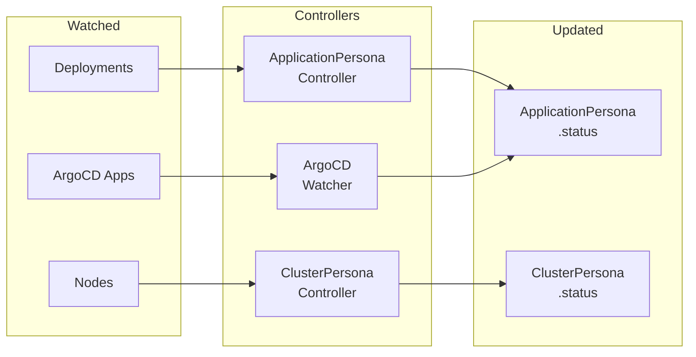
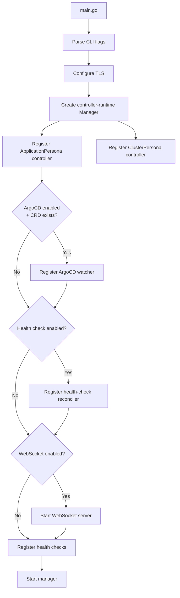

The dorgu operator is a Kubernetes operator built with [controller-runtime](https://github.com/kubernetes-sigs/controller-runtime) that manages five custom resources: **ApplicationPersona**, **ClusterPersona**, **IncidentMemory**, **RemediationAction**, and **DorguEvent**. It follows the standard operator pattern of watching resources and reconciling desired state.

## Design principles

| Principle | Description |
|-----------|-------------|
| **Read-only workloads** | The operator NEVER writes to workload resources (Deployments, Services). It writes only its own CRDs. |
| **Fail-open** | If the operator is down or encounters errors, workloads are unaffected. It registers no admission webhook, so nothing in the request path of your Deployments depends on it. |
| **Opt-in features** | The core controllers and the self-healing loop are on by default. AI, Prometheus, and WebSocket require explicit opt-in. |
| **No ArgoCD dependency** | ArgoCD integration uses the unstructured API — no compile-time dependency on ArgoCD types. |
| **Graceful degradation** | Missing integrations (no Prometheus, no ArgoCD) are silently skipped without affecting core functionality. |

## Project structure

```
dorgu-operator/
├── api/v1/                           # CRD type definitions
│   ├── applicationpersona_types.go   # ApplicationPersona spec + status
│   ├── clusterpersona_types.go       # ClusterPersona spec + status
│   ├── incidentmemory_types.go       # IncidentMemory spec + status
│   ├── remediationaction_types.go    # RemediationAction spec + status
│   ├── dorguevent_types.go           # DorguEvent spec
│   ├── groupversion_info.go          # API group registration
│   └── zz_generated.deepcopy.go     # Generated deep copy methods
│
├── cmd/                              # Entrypoint
│   ├── main.go                       # Manager setup, controller registration
│   └── config.go                     # CLI flag parsing
│
├── internal/
│   ├── controller/                   # Reconciliation controllers
│   │   ├── applicationpersona_controller.go    # Main reconciler
│   │   ├── applicationpersona_validation.go    # Validation logic
│   │   ├── applicationpersona_status.go        # Status update helpers
│   │   ├── clusterpersona_controller.go        # Cluster reconciler
│   │   ├── clusterpersona_discovery.go         # Node/resource discovery
│   │   ├── clusterpersona_addons.go            # Add-on detection
│   │   ├── argocd_watcher.go                   # ArgoCD Application watcher
│   │   └── controller_helpers.go               # Shared utilities
│   │
│   ├── metrics/                      # Prometheus integration
│   │   └── prometheus_client.go      # PromQL queries for baselines
│   │
│   ├── detection/                    # Failure signal detection
│   ├── diagnosis/                    # Rule-based and AI diagnosis
│   ├── remediation/                  # Proposer, guardrails, executor
│   ├── events/                       # DorguEvent pipeline and retention
│   ├── llm/                          # Model provider clients
│   ├── workload/                     # Live workload and ownership reads
│   │
│   └── websocket/                    # Optional WebSocket server
│       ├── server.go                 # Server lifecycle, client management
│       ├── handlers.go               # Message handlers
│       └── protocol.go              # Message types and payloads
│
├── charts/dorgu-operator/            # Helm chart
├── config/                           # Kustomize manifests (CRDs, RBAC)
└── test/e2e/                         # End-to-end tests
```

## Reconciliation model

The operator runs three independent controllers, each watching different resources:



| Controller | Watches | Updates | Requeue interval |
|------------|---------|---------|-----------------|
| ApplicationPersona | Deployments, Pods | `.status` on ApplicationPersona | 60 seconds |
| ClusterPersona | Nodes, Namespaces, Pods | `.status` on ClusterPersona | 5 minutes |
| ArgoCD Watcher | ArgoCD Applications | `.status.argocd` on ApplicationPersona | 30 seconds |

## Startup sequence



## CRD ownership model

The operator follows a strict ownership model for the two persona CRDs:

| CRD | Scope | Created by | Spec owned by | Status owned by |
|-----|-------|------------|---------------|-----------------|
| ApplicationPersona | Namespaced | You, `dorgu persona import`, or GitOps | You | Operator |
| ClusterPersona | Cluster-scoped | Operator (auto-creates `dorgu-cluster`), or you via GitOps | You | Operator |

You manage the `.spec` of each persona. The operator manages `.status`, writing validation results, health information, resource baselines, and ArgoCD sync state. The one exception is an approved remediation, where the operator patches the persona's `.spec` to the value you approved.

## RBAC model

Every write verb the operator holds targets a `dorgu.io` CRD, a Kubernetes `Event`, or a leader-election `Lease`. Everything else in the cluster is read-only.

| Resource | Verbs | Purpose |
|----------|-------|---------|
| `applicationpersonas` (+ `/status`, `/finalizers`) | get, list, watch, create, update, patch, delete | Reconcile personas; write status. The `spec` is patched only via a human-approved `RemediationAction`. |
| `clusterpersonas` (+ `/status`, `/finalizers`) | get, list, watch, create, update, patch, delete | Auto-create and reconcile the singleton `dorgu-cluster` |
| `incidentmemories` (+ `/status`) | get, list, watch, create, update, patch | Open and update incident records. No `delete`. |
| `remediationactions` (+ `/status`) | get, list, watch, create, update, patch | Propose fixes and record their lifecycle. No `delete`. |
| `dorguevents` | create, get, list, watch, delete | Write-once classified events (no `update`). `delete` is the retention cleaner pruning Dorgu's own records: [why it is there](/security-and-permissions#why-the-operator-can-delete-dorguevents). |
| `apps/deployments`, `apps/replicasets` | **get, list, watch** | Persona validation, ownership detection, pod-to-Deployment correlation |
| `pods`, `namespaces`, `nodes` | get, list, watch | Detection signals and cluster discovery |
| `events` | get, list, watch, create, patch | The event watcher, plus recording Dorgu's own Kubernetes Events |
| `metrics.k8s.io/pods` | get, list | Container-level usage and saturation. Needs metrics-server; optional. |
| `coordination.k8s.io/leases` | get, list, watch, create, update, patch, delete | Leader election, when `leaderElection.enabled=true` |
| `argoproj.io/applications` | get, list, watch | Sync status tracking. Only when `argocd.enabled=true`. |

<Warning>
  **No `create`, `update`, `patch`, or `delete` on Deployments. No access to Secrets.** There are no rules for Services, StatefulSets, DaemonSets, ConfigMaps, or RBAC resources at all. That is what makes "the operator never writes workloads" a fact about your API server rather than a promise about Dorgu's source code.

  The full ClusterRole, the denied verbs called out explicitly, and a `kubectl auth can-i` recipe to verify it on your own cluster: [security and permissions](/security-and-permissions).
</Warning>

<CardGroup cols={2}>
  <Card title="Security and permissions" icon="shield-check" href="/security-and-permissions">
    The ClusterRole in full, and what it deliberately omits
  </Card>
  <Card title="Ownership model" icon="user-lock" href="/ownership-model">
    Which workloads the CLI will patch, and which it only recommends for
  </Card>
  <Card title="CRD specification" icon="file-code" href="/cli/architecture/crds">
    Full ApplicationPersona and ClusterPersona schema
  </Card>
  <Card title="Configuration" icon="gear" href="/operator/configuration/overview">
    All operator configuration options
  </Card>
</CardGroup>
